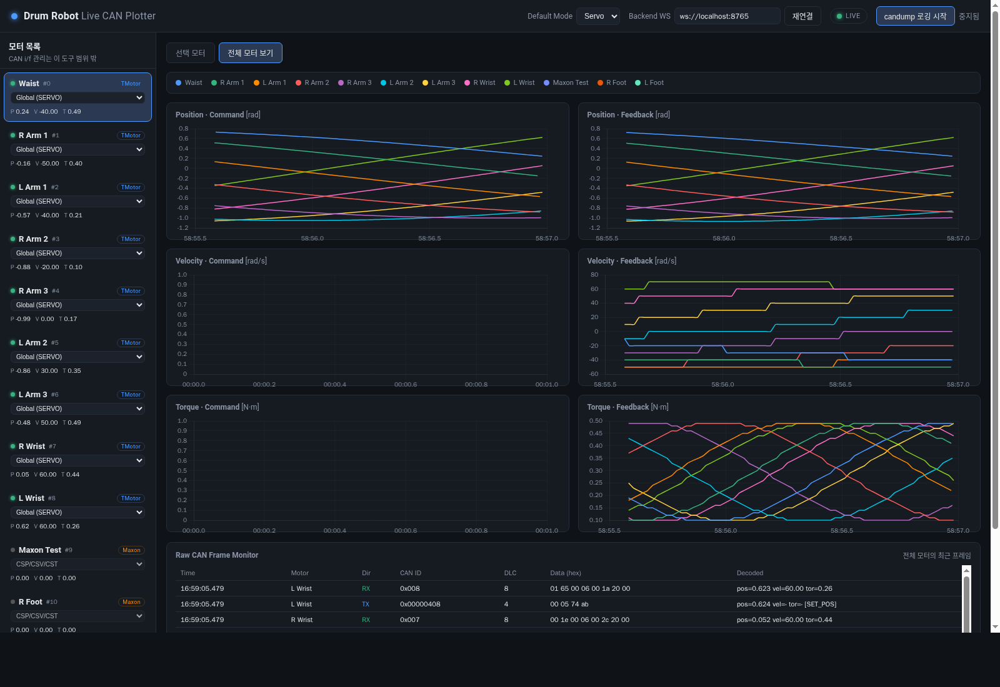
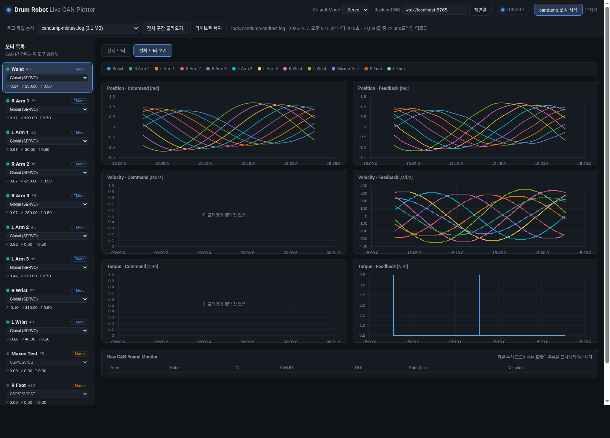

# Drum Robot Live CAN Plotter

드럼로봇(Phil)의 CAN 버스를 옆에서 엿들어서, 각 모터에 **어떤 명령이 나가고 어떤 피드백이 들어오는지**
실시간으로 그려주는 도구.

**로봇 제어 코드에는 어떤 간섭도 하지 않는다.** CAN 버스를 읽기만 하고, 아무것도 송신하지 않으며,
로봇 코드를 수정하지도 않는다. 로봇을 돌리면서 그냥 켜 두면 된다.



- 모터별 **위치 / 속도 / 토크**를 명령(TX)과 피드백(RX)으로 나눠서 플로팅
- **Servo / MIT** 모드를 GUI에서 선택 (모터별 개별 지정도 가능)
- **전체 모터 보기**: 명령 전용 플롯과 피드백 전용 플롯을 나란히
- **candump 자동 로깅**: CAN 이 살아있으면 모든 프레임을 `logs/` 에 자동으로 기록
- **로그 파일 분석**: 기록해둔 candump 로그의 전체 구간을 한 화면에 플로팅

## 설치

```bash
pip3 install -r requirements.txt
```

`candump` 로깅 기능을 쓰려면 can-utils 가 필요하다.

```bash
sudo apt install can-utils
```

## 실행

로봇과는 별개로 띄운다. 순서는 상관없고, 로봇을 먼저 켜든 나중에 켜든 알아서 붙는다.

```bash
./run.sh                 # 백엔드 + GUI (브라우저도 자동으로 열림)
```

Ctrl+C 한 번이면 띄운 것들이 전부 정리된다.

| 옵션 | 설명 |
|---|---|
| `-i, --iface can0,can1` | CAN 인터페이스 지정 (기본: 자동 탐색) |
| `--replay FILE` | candump 로그 재생 모드 |
| `--ws-port N` / `--gui-port N` | 포트 변경 (기본 8765 / 8099) |
| `--no-browser` | 브라우저 자동 실행 안 함 |
| `--keep-open` | 끝나도 창을 닫지 않고 대기 (별도 터미널로 띄울 때) |

직접 띄우고 싶으면 터미널 두 개로 나눠도 된다.

```bash
python3 backend/can_bridge.py    # CAN 수신 + 디코딩
python3 -m http.server 8099      # GUI
```

브라우저에서 <http://localhost:8099/index.html> 접속.

> `index.html` 을 파일 탐색기에서 더블클릭하면(`file://`) 설정 파일을 못 읽어서 동작하지 않는다.
> 반드시 위처럼 http 로 열 것.

백엔드가 안 떠 있으면 화면은 목업(가짜) 데이터로 움직인다. 우측 상단 배지로 구분할 수 있다:
`LIVE` / `MOCK DATA` / `LOG FILE`.

### 백엔드 옵션

| 옵션 | 설명 |
|---|---|
| (없음) | `can0~can3`, `vcan0` 등을 자동으로 찾아서 전부 수신 |
| `-i can0,can1` | 인터페이스 직접 지정 |
| `--replay logs/candump-xxx.log` | 기록해둔 로그를 실시간처럼 재생 |
| `--replay-speed 0.5` | 재생 배속 (0 이면 최대 속도) |
| `--host 0.0.0.0` | 다른 PC에서 GUI로 붙게 열어줌 (기본은 로컬만) |

## CAN 인터페이스 준비

이 도구는 CAN 인터페이스를 올리거나 내리지 않는다. 미리 올려둬야 한다.

```bash
sudo ip link set can0 up type can bitrate 1000000
ip -details link show can0     # state UP, ERROR-ACTIVE 인지 확인
```

USB CAN 어댑터는 뽑았다 꽂으면 설정이 날아간 채 DOWN 으로 올라오므로 위 명령을 다시 해줘야 한다.
반대로 **플로터는 재시작하지 않아도 된다** — 링크가 죽었다 살아나면 알아서 다시 붙는다.

### 인터페이스가 여러 개일 때 / 일부만 연결했을 때

**아무 설정도 필요 없다.** 어느 모터가 어느 인터페이스에 있는지 미리 정해두지 않고,
존재하는 CAN 인터페이스를 전부 열어서 동시에 수신한 뒤 프레임의 노드 ID로 모터를 찾는다.
4개 중 2개만 연결해서 테스트해도 그 2개에서 오는 건 그대로 나온다.

- 없거나 DOWN 인 인터페이스는 그 하나만 재시도하고, 나머지는 정상 동작한다.
- 실행 중에 어댑터를 새로 꽂아도 5초 안에 알아서 붙는다 (`-i` 로 직접 지정한 경우는 제외).
- candump 로깅에는 살아있는 인터페이스만 넘긴다. 새 인터페이스가 붙으면 로그를 새 파일로 다시 시작한다.
- 사이드바에 `can0(UP) can1(DOWN) · 12,043/12,043 프레임 디코딩` 처럼 상태가 다 보인다.

> 제약: 서로 다른 버스에 **같은 노드 ID** 가 있으면 구분하지 못하고 한 모터로 합쳐진다.
> 현재 `config/motors.json` 은 0~11 이 전부 유일해서 문제없다.

## 모터 설정

**모터 목록은 로봇 코드(Phil)의 `config/motors.json` 을 그대로 읽는다.** 여기서 따로 관리하지 않으므로,
로봇 쪽에서 모터 ID나 종류를 바꾸면 플로터가 자동으로 따라간다. 읽기만 하고 쓰지 않는다.

경로는 알아서 찾는다 (`../Phil/...`, `~/Phil/...` 등). 다른 곳에 있으면 지정하면 된다.

```bash
PLOTTER_ROBOT_CONFIG=/경로/Phil/drumrobot_server/config/motors.json ./run.sh
```

또는 `config/motors.json` 의 `robotConfigPath` 에 적어두면 된다.
로봇 설정을 못 찾으면 같은 파일의 `fallbackMotors` 목록으로 동작한다 (백엔드 시작 로그에 어느 쪽을 쓰는지 찍힌다).

플로터 쪽 `config/motors.json` 에는 로봇 설정에 없는 것들만 둔다:

| 항목 | 의미 |
|---|---|
| `defaultMode` | 기본 해석 모드 (`servo` / `mit`) |
| `robotConfigPath`, `robotConfigSearch` | 로봇 설정 파일 위치 |
| `motorTypes` | 기종별 속도/토크/전류 한계 (MIT 모드 환산용) |
| `maxon` | PDO/SDO ID 오프셋, 정격 토크, 엔코더 분해능 |
| `tmotor` | MIT 공통 범위, 극수, 서보 상태 프레임의 packet id |
| `fallbackMotors` | 로봇 설정을 못 찾았을 때 쓸 예비 목록 |

**고친 다음에는 백엔드 재시작 + 브라우저 새로고침.**

## 화면 사용법

**선택 모터** 탭 — 왼쪽 목록에서 모터를 고르면 위치/속도/토크 3개 차트를 크게 본다.
실선이 명령, 점선이 피드백. 아래 `Raw CAN Frame Monitor` 에 실제 프레임이 흐른다.

**전체 모터 보기** 탭 — 모든 모터를 한 화면에. 왼쪽 열이 명령, 오른쪽 열이 피드백이다.
모터별 색은 위 범례에 있다.

**Default Mode** — Servo / MIT 선택. 모터별로 다르게 쓰면 목록의 각 모터에서 개별 지정하면 된다
(`Global` 로 두면 위 설정을 따라간다).

> **명령 쪽 차트 일부가 비는 건 정상이다.** 서보 명령 프레임에는 그 명령에 해당하는 값만 들어있다.
> 속도 명령(`SET_RPM`)이면 속도만, 위치 명령(`SET_POS`)이면 위치만 담긴다. 없는 값은
> "이 프레임에 해당 값 없음" 으로 비워둔다. 피드백은 항상 위치·속도·전류가 다 온다.
> (로봇이 속도 제어로 돌 때 위치·토크 차트에 피드백선만 보이는 게 이 때문이다.)

## candump 로깅

**CAN 인터페이스가 살아있으면 자동으로 기록된다.** 백엔드가 뜰 때 `candump -l` 을 같이 띄워
모든 CAN 프레임을 `logs/candump-<날짜>_<시각>.log` 에 원본 그대로 남긴다.
로봇 로깅과는 별개이고, 제어 프로세스가 떠 있든 아니든 버스에 흐르는 건 다 남는다.

- CAN 이 나중에 올라와도 그때 알아서 기록을 시작한다.
- 링크가 끊기거나 USB 를 다시 꽂아서 candump 가 죽으면 새 파일로 다시 시작한다.
- 상단 버튼으로 직접 끄면 자동으로 다시 켜지지 않는다 (다시 켜려면 버튼을 누르면 된다).
- 자동 기록을 아예 원하지 않으면 백엔드에 `--no-auto-log` 를 준다.

트래픽이 없어도 candump 는 파일부터 만들기 때문에, 백엔드를 여러 번 재시작하면 0바이트 로그가
생긴다. 다음 실행 때 10분 이상 지난 빈 로그는 알아서 정리한다.

## 로그 파일 전체 구간 분석



상단 **로그 파일 분석** 에서 `logs/` 의 파일을 고르고 **전체 구간 불러오기**.
파일 전체를 디코딩해서 처음부터 끝까지 한 화면에 그린다. **라이브로 복귀** 로 되돌아간다.

긴 로그는 자동으로 축약해서 그리는데, 구간마다 최소·최대값을 남기는 방식이라
타격 순간의 토크 스파이크 같은 건 뭉개지지 않는다. (18MB / 43만 줄 기준 2~3초)

특정 로그를 링크로 바로 열 수도 있다:

```
http://localhost:8099/index.html#view=overview&file=logs/candump-2026-09-07_170001.log
```

## 아무것도 안 나올 때

왼쪽 위 모터 목록 아래에 인터페이스 상태와 디코딩 카운터가 표시된다.
`can0(UP) · 12,043/12,043 프레임 디코딩` 처럼 나오면 정상이다.

| 증상 | 원인 |
|---|---|
| `can0(DOWN)` 또는 `링크 DOWN` 경고 | 인터페이스가 안 올라와 있다. 위 "CAN 인터페이스 준비" 참고 |
| 디코딩 카운터가 `0/12,043` | 프레임은 들어오는데 매핑이 안 된다. 로봇 설정을 제대로 읽었는지(백엔드 시작 로그) 또는 모드(Servo/MIT) 확인 |
| `매핑 안 되는 ID: can0 0x555 ...` | 실제 버스에 흐르는 ID 다. 이 값에 맞춰 설정을 고치면 된다 |
| 배지가 `MOCK DATA` | 백엔드에 연결이 안 됐다. 백엔드가 떠 있는지, WS 주소가 맞는지 확인 후 **재연결** |
| 모든 모터가 "신호 없음" | 버스에 트래픽이 없다. 로봇 제어 프로세스가 도는지 확인 |

백엔드 터미널에도 같은 내용이 찍힌다.

## 주의

**이 도구는 CAN 버스에 아무것도 송신하지 않는다.** 직접 `cansend` 로 테스트할 때는 조심할 것 —
모터가 물려 있으면 명령 프레임이 실제로 관절을 움직이고, 반대로 버스에 다른 노드가 없으면
ACK를 못 받아 어댑터가 bus-off 로 갈 수 있다.

하드웨어 없이 시험해보려면 가상 CAN 을 쓰면 된다.

```bash
sudo modprobe vcan
sudo ip link add dev vcan0 type vcan
sudo ip link set up vcan0
```

## 참고

- 프레임 해석은 로봇 코드의 `src/hardware/motor_codec.cpp` 인코딩을 그대로 뒤집은 것이다.
- Servo 모드의 토크 값은 사실 **전류[A]** 다 (원본 코드가 토크 상수를 곱하지 않는다).
  MIT 모드는 기종 Kt 를 아는 경우에만 N·m 로 환산한다.
- Servo 속도는 버스 위에서 **ERPM(전기적 RPM)** 으로 오간다. 차트에는 로봇 설정의 극수·기어비로
  나눠 관절 속도 `rad/s` 로 환산해서 그린다 (명령·피드백 동일). 로봇이 남기는 자체 로그와
  숫자를 비교할 일이 있으면 그쪽은 ERPM 이라는 걸 감안할 것.
- Maxon(손목·페달)은 PDO 로 주고받는다. 피드백은 `0x180+노드`, 목표 위치 명령은 `0x300+노드`
  를 숫자로 풀고, 나머지 제어 PDO/SDO 는 원본 프레임만 보여준다.
- 머리(Dynamixel)는 CAN 을 쓰지 않으므로 목록에 나오지 않는다.
- 화면 스크린샷은 vcan 가상 데이터로 찍은 것이다.
